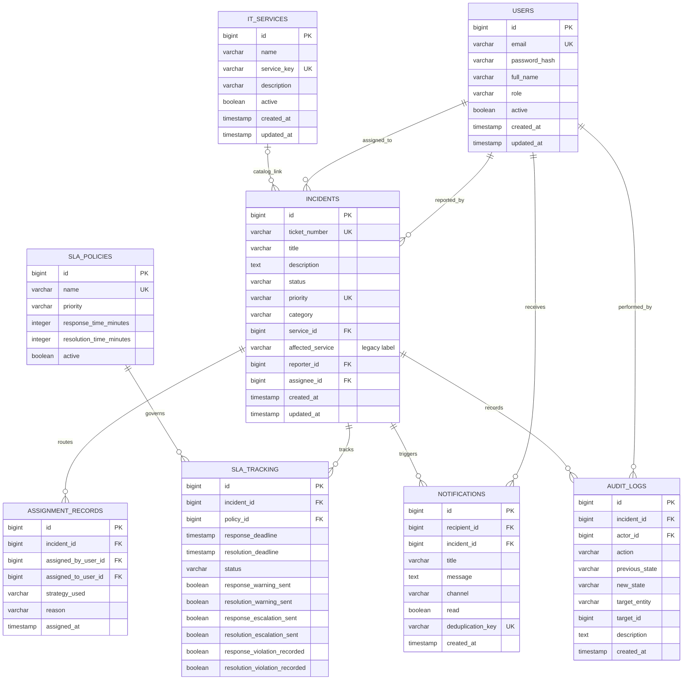

# I-ITSM Database Design Document
**Database Management System**: PostgreSQL 15+ (Hosted on Supabase)  
**Schema**: `public`  
**ORM**: Spring Data JPA (Hibernate 6.x)  
**Strategy**: Snake_case table and column identifiers with foreign key referential integrity.

**Verification scope:** the SQL migrations are authoritative. The documentation below describes mapped columns rather than a second hand-maintained schema definition. PostgreSQL is configured as the target, but was not available for live validation in this workspace; tests used H2 PostgreSQL compatibility mode.

## IT service catalog

Flyway V5 creates `it_services` with a unique normalized `service_key`, name, description, active flag, and timestamps. It adds nullable `incidents.service_id` with a foreign key and index. Existing distinct `incidents.affected_service` labels are copied as active catalog rows and linked to incidents; the legacy text column remains unchanged and continues to support older clients and historical incidents. New service references are optional at the database layer for backward compatibility, while the incident API validates any supplied service ID as active.

## Reporting query behavior

Phase 5 adds no tables or migrations. Reporting uses database-side `COUNT`, grouped aggregates and average-duration projections over the existing `incidents`, `sla_tracking`, `users`, and `technician_profiles` records. Search applies pageable criteria and fetches reporter/assignee relations in one query to avoid per-row lazy-loading queries. Incident CSV export reads in bounded pages. Report date ranges are optional; when supplied, the start is inclusive and end is exclusive. Daily trend buckets use the database session's date cast for `TIMESTAMP WITH TIME ZONE`; deployments should use a consistent database session timezone for comparable daily charts. Technician active workload is computed as a current snapshot while assigned/resolved counters use the requested incident creation range. SLA compliance treats each tracking row as two targets (response and resolution); a target is compliant unless its corresponding breach flag is set. No live database was altered as part of Phase 5.

---

## 1. Entity-Relationship Overview



---

## 2. Table Specifications

### A. `users` Table
Stores system actors. Current roles are ADMIN, TECHNICIAN and EMPLOYEE; MANAGER and AGENT values remain readable for legacy records.
```sql
CREATE TABLE users (
    id BIGSERIAL PRIMARY KEY,
    email VARCHAR(180) NOT NULL UNIQUE,
    password_hash VARCHAR(255) NOT NULL,
    full_name VARCHAR(120) NOT NULL,
    role VARCHAR(32) NOT NULL DEFAULT 'EMPLOYEE', -- ADMIN, TECHNICIAN, EMPLOYEE; legacy MANAGER/AGENT retained
    active BOOLEAN NOT NULL DEFAULT TRUE,
    created_at TIMESTAMP WITH TIME ZONE NOT NULL DEFAULT CURRENT_TIMESTAMP,
    updated_at TIMESTAMP WITH TIME ZONE NOT NULL DEFAULT CURRENT_TIMESTAMP
);

CREATE INDEX idx_users_role ON users(role);
CREATE INDEX idx_users_email ON users(email);
```

---

### B. `incidents` Table
The primary domain entity capturing service disruptions and support requests.
```sql
CREATE TABLE incidents (
    id BIGSERIAL PRIMARY KEY,
    ticket_number VARCHAR(32) NOT NULL UNIQUE, -- e.g. INC-20261114-001
    title VARCHAR(200) NOT NULL,
    description TEXT NOT NULL,
    status VARCHAR(32) NOT NULL DEFAULT 'OPEN', -- includes legacy OPEN and current lifecycle values
    priority VARCHAR(32) NOT NULL DEFAULT 'MEDIUM', -- LOW, MEDIUM, HIGH, CRITICAL
    category VARCHAR(64) NOT NULL DEFAULT 'SOFTWARE', -- HARDWARE, SOFTWARE, NETWORK, ACCESS
    reporter_id BIGINT NOT NULL REFERENCES users(id),
    assignee_id BIGINT REFERENCES users(id),
    created_at TIMESTAMP WITH TIME ZONE NOT NULL DEFAULT CURRENT_TIMESTAMP,
    updated_at TIMESTAMP WITH TIME ZONE NOT NULL DEFAULT CURRENT_TIMESTAMP
);

CREATE INDEX idx_incidents_status ON incidents(status);
CREATE INDEX idx_incidents_priority ON incidents(priority);
CREATE INDEX idx_incidents_assignee ON incidents(assignee_id);
```

---

### C. `assignment_records` Table
Audits routing strategy actions (Strategy Pattern output history).
```sql
CREATE TABLE assignment_records (
    id BIGSERIAL PRIMARY KEY,
    incident_id BIGINT NOT NULL REFERENCES incidents(id) ON DELETE CASCADE,
    assigned_by_user_id BIGINT REFERENCES users(id) ON DELETE SET NULL,
    assigned_to_user_id BIGINT NOT NULL REFERENCES users(id) ON DELETE RESTRICT,
    strategy_used VARCHAR(64) NOT NULL, -- ROUND_ROBIN, WORKLOAD_BALANCED, MANUAL
    reason VARCHAR(255),
    created_at TIMESTAMP WITH TIME ZONE NOT NULL DEFAULT CURRENT_TIMESTAMP,
    updated_at TIMESTAMP WITH TIME ZONE NOT NULL DEFAULT CURRENT_TIMESTAMP
);

CREATE INDEX idx_assignment_incident ON assignment_records(incident_id);
```

---

### D. `sla_policies` & `sla_tracking` Tables
Defines and tracks Service Level Agreements.
```sql
CREATE TABLE sla_policies (
    id BIGSERIAL PRIMARY KEY,
    name VARCHAR(100) NOT NULL UNIQUE,
    priority VARCHAR(32) NOT NULL UNIQUE, -- Maps 1:1 with Incident Priority
    response_time_minutes INT NOT NULL,
    resolution_time_minutes INT NOT NULL,
    active BOOLEAN NOT NULL DEFAULT TRUE,
    created_at TIMESTAMP WITH TIME ZONE NOT NULL DEFAULT CURRENT_TIMESTAMP
);

CREATE TABLE sla_tracking (
    id BIGSERIAL PRIMARY KEY,
    incident_id BIGINT NOT NULL REFERENCES incidents(id) ON DELETE CASCADE,
    policy_id BIGINT NOT NULL REFERENCES sla_policies(id) ON DELETE RESTRICT,
    response_deadline TIMESTAMP WITH TIME ZONE NOT NULL,
    resolution_deadline TIMESTAMP WITH TIME ZONE NOT NULL,
    acknowledged_at TIMESTAMP WITH TIME ZONE,
    resolved_at TIMESTAMP WITH TIME ZONE,
    response_warning_sent BOOLEAN NOT NULL DEFAULT FALSE,
    resolution_warning_sent BOOLEAN NOT NULL DEFAULT FALSE,
    response_escalation_sent BOOLEAN NOT NULL DEFAULT FALSE,
    resolution_escalation_sent BOOLEAN NOT NULL DEFAULT FALSE,
    response_violation_recorded BOOLEAN NOT NULL DEFAULT FALSE,
    resolution_violation_recorded BOOLEAN NOT NULL DEFAULT FALSE,
    status VARCHAR(24) NOT NULL DEFAULT 'HEALTHY', -- HEALTHY, AT_RISK, BREACHED
    created_at TIMESTAMP WITH TIME ZONE NOT NULL DEFAULT CURRENT_TIMESTAMP,
    updated_at TIMESTAMP WITH TIME ZONE NOT NULL DEFAULT CURRENT_TIMESTAMP
);

CREATE INDEX idx_sla_incident ON sla_tracking(incident_id);
CREATE INDEX idx_sla_status ON sla_tracking(status);
```

---

### E. `notifications` Table
Stores in-app messages and dispatch logs (Observer Pattern target).
```sql
CREATE TABLE notifications (
    id BIGSERIAL PRIMARY KEY,
    recipient_id BIGINT NOT NULL REFERENCES users(id) ON DELETE CASCADE,
    incident_id BIGINT REFERENCES incidents(id) ON DELETE CASCADE,
    title VARCHAR(160) NOT NULL,
    message TEXT NOT NULL,
    channel VARCHAR(32) NOT NULL DEFAULT 'IN_APP', -- IN_APP, EMAIL, WEBHOOK
    is_read BOOLEAN NOT NULL DEFAULT FALSE,
    deduplication_key VARCHAR(180) UNIQUE,
    created_at TIMESTAMP WITH TIME ZONE NOT NULL DEFAULT CURRENT_TIMESTAMP,
    updated_at TIMESTAMP WITH TIME ZONE NOT NULL DEFAULT CURRENT_TIMESTAMP
);

CREATE INDEX idx_notifications_recipient ON notifications(recipient_id);
CREATE INDEX idx_notifications_is_read ON notifications(is_read);
```

---

### F. `audit_logs` Table
Maintains an append-only change history of system actions.
```sql
CREATE TABLE audit_logs (
    id BIGSERIAL PRIMARY KEY,
    incident_id BIGINT REFERENCES incidents(id) ON DELETE CASCADE,
    actor_id BIGINT REFERENCES users(id) ON DELETE SET NULL,
    action VARCHAR(64) NOT NULL, -- CREATED, ASSIGNED, STATUS_CHANGED, COMMENTED
    previous_state VARCHAR(255),
    new_state VARCHAR(255),
    target_entity VARCHAR(64),
    target_id BIGINT,
    description TEXT NOT NULL DEFAULT 'Legacy audit entry',
    created_at TIMESTAMP WITH TIME ZONE NOT NULL DEFAULT CURRENT_TIMESTAMP,
    updated_at TIMESTAMP WITH TIME ZONE NOT NULL DEFAULT CURRENT_TIMESTAMP
);

CREATE INDEX idx_audit_incident ON audit_logs(incident_id);
CREATE INDEX ix_audit_target_created ON audit_logs(target_entity, target_id, created_at DESC);
```

---

## 3. Supabase Integration Guide

1. Create a project at [supabase.com](https://supabase.com).
2. Under **Project Settings > Database**, retrieve the PostgreSQL URI.
3. Replace your `.env` connection variables:
   ```env
   DB_URL=jdbc:postgresql://aws-0-ap-south-1.pooler.supabase.com:5432/postgres?sslmode=require
   DB_USERNAME=postgres.your_project_ref
   DB_PASSWORD=your_supabase_database_password
   ```
4. Flyway applies schema migrations; Hibernate DDL mode is `validate` so runtime startup does not make unmanaged schema changes.

---

## 4. Additive Migrations

The backend uses Flyway migrations V1–V6. V1 creates missing baseline tables with `IF NOT EXISTS`, adds incident/SLA/audit/notification columns with defaults, and seeds the four default SLA policies only when a priority has no policy. V2 adds indexes for existing repository query paths. V3 adds persisted SLA escalation flags. V4 adds categories and feedback. V5 adds the service catalog and nullable incident service association, importing existing affected-service labels without deleting or rewriting them. V6 adds nullable generic audit target columns and their lookup index without modifying existing audit rows. Hibernate uses `validate` after Flyway.

New incident columns are `impact`, `urgency`, `business_criticality`, `affected_user_count`, `affected_service`, `service_criticality`, `priority_score`, `priority_explanation`, `resolution_details`, and lifecycle timestamps. Existing incidents receive conservative default scoring inputs; their stored priority remains unchanged until an edit causes a recalculation.

New tables:

- `technician_profiles` and `technician_skills`: technician availability, experience, workload limit and category skills.
- `assignment_configuration`: active assignment strategy.
- `sla_tracking` and `sla_history`: persistent response/resolution deadlines, acknowledgement/resolution timestamps, one-time warning/violation flags and event history.
- `incident_activities`: investigation notes, information requests and employee responses.

Existing tables receive only additive fields: `audit_logs.description`, `audit_logs.target_entity`, `audit_logs.target_id` and `notifications.deduplication_key` (backfilled with unique `LEGACY:<id>` keys before a unique index is created). Notification history and audit rows are retained. Generic target columns have no foreign key because a target may be in different tables; incident audit rows continue to use the separately constrained `incident_id`.

The supplied workspace had no reachable PostgreSQL instance during implementation. Both migrations have been applied in the H2 PostgreSQL compatibility test profile and the resulting schema passed Hibernate validation. This is not a substitute for running against PostgreSQL. The `IF NOT EXISTS` table clauses do not retrofit every constraint from the `CREATE TABLE` definitions onto a pre-existing table, and V1 adds only explicitly listed legacy columns. Before applying to an existing PostgreSQL database, compare its actual DDL and Flyway history; the live schema was not inspected here.
