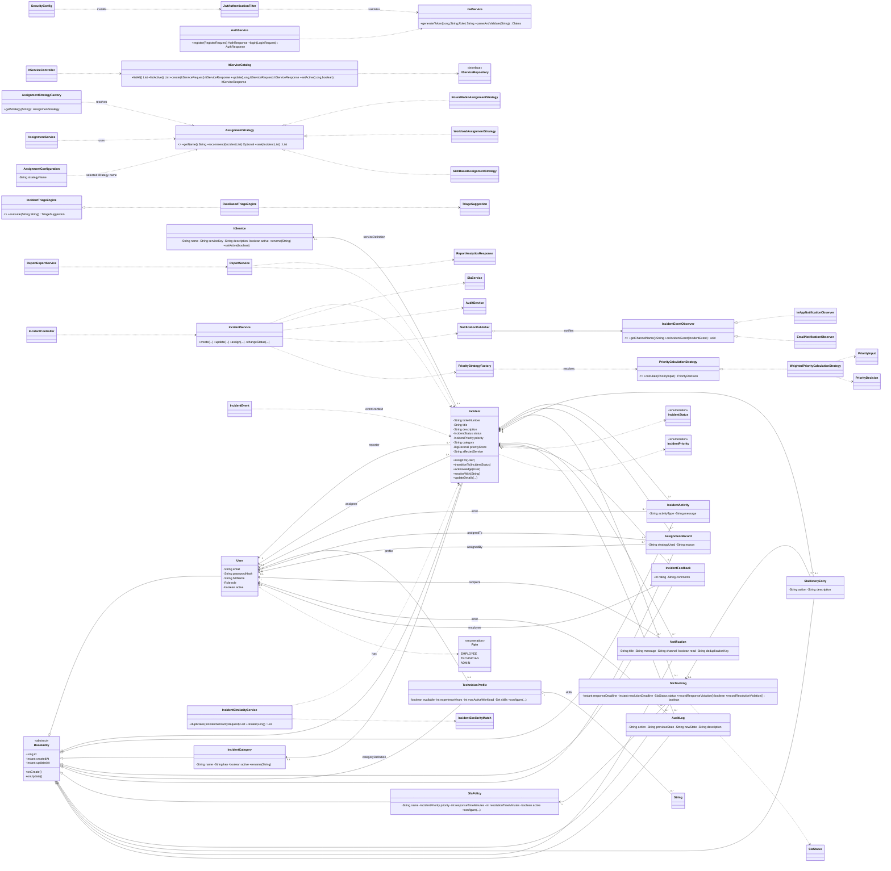

# I-ITSM Implementation Class Diagram

The diagram includes representative domain, service, strategy, observer, and API classes verified in Java source. DTOs and repositories are omitted where they would obscure the domain relationships. Method signatures are abbreviated to the important public operations.

## OOP and pattern evidence

- **Encapsulation:** entity state is private; behavior such as incident transitions, category renaming, technician configuration, and SLA flag updates is implemented on domain objects.
- **Inheritance:** JPA domain entities extend the mapped superclass `BaseEntity` for IDs and timestamps.
- **Abstraction and interfaces:** `AssignmentStrategy`, `PriorityCalculationStrategy`, `IncidentTriageEngine`, and `IncidentEventObserver` describe replaceable behavior.
- **Polymorphism / Strategy:** round-robin, workload, and skill-based assignment strategies implement one interface; the configured strategy is selected through `AssignmentStrategyFactory`. `WeightedPriorityCalculationStrategy` implements priority calculation.
- **Factory:** assignment and priority strategy factories resolve strategy implementations.
- **Observer:** `NotificationPublisher` notifies `IncidentEventObserver` implementations, including the persisted in-app observer and simulated email observer.
- **Composition and association:** services compose collaborators through dependency injection; entity relationships shown are JPA associations. `TechnicianProfile` holds an element collection of skill strings.
- Role is an enum rather than a class hierarchy; no inheritance between Employee, Technician, and Administrator Java classes was found.

## Diagram limits

The diagram shows selected classes, not every controller, repository, DTO, or method. Relationships from JPA fields are concrete; service dependency arrows summarize constructor-injected/use relationships and are not database relationships. `AssignmentConfiguration` persists a strategy name, not a direct JPA link to a strategy object. Email delivery is simulated.
