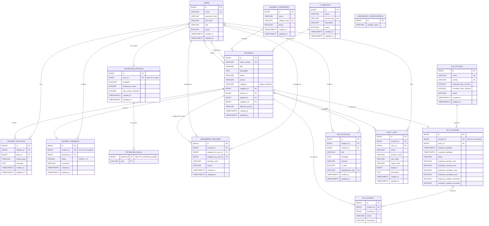

# I-ITSM Entity Relationship Diagram

This diagram is derived from JPA entities and Flyway migrations V1–V6. It shows persistent tables only. `BaseEntity` contributes `id`, `created_at`, and `updated_at` to entities that extend it; these common columns are noted in the table descriptions instead of repeated in every entity box.

## Keys, constraints, and interpretation

- Primary and foreign keys follow V1–V4. `users.email`, `incidents.ticket_number`, `incident_categories.category_key`, `technician_profiles.user_id`, `sla_policies.name`, `sla_policies.priority`, `sla_tracking.incident_id`, and `incident_feedback.incident_id` are unique in the migration/entity mapping.
- `technician_skills` has composite primary key `(profile_id, skill)` and a foreign key to `technician_profiles`. This is JPA `@ElementCollection`, not a separate domain entity.
- `incident_feedback.rating` is constrained to 1–5 in V4. Feedback’s one-per-incident rule is database-enforced by a unique incident FK.
- V4 keeps `incidents.category` as the historical/display string, adds nullable `category_id`, links matching legacy values to categories, and adds an index. The category FK is nullable, so an incident can retain an unmatched legacy category without a linked category record.
- V5 adds `it_services`, imports distinct existing `affected_service` labels, and adds nullable `incidents.service_id` plus a foreign key and index. The original text remains for backward compatibility; the association is nullable for legacy incidents.
- V2 adds query indexes; V3 adds SLA escalation state flags. The diagram focuses on relational keys and representative columns; migration files remain authoritative for all columns and indexes.
- `assignment_configuration` stores the selected strategy name, not a foreign key to a strategy row. There is currently one seeded configuration row with `id=1`.
- ER cardinalities mirror unique constraints and nullable columns where present. Relationship lines are database-enforced only where the corresponding FK/unique constraint exists in Flyway. JPA associations or application semantics without a migration FK are not assumed to be enforced.
- No live PostgreSQL migration or Hibernate validation was performed for this documentation task. PostgreSQL compatibility is inferred from PostgreSQL-targeted SQL (`BIGINT GENERATED BY DEFAULT AS IDENTITY`, `TIMESTAMP WITH TIME ZONE`, `UPDATE ... FROM`, and `CREATE INDEX IF NOT EXISTS`); live migration verification remains pending.
- V6 adds nullable `audit_logs.target_entity` and `audit_logs.target_id` plus a target lookup index. These generic target columns intentionally have no foreign key because they can refer to users, IT services, incident categories, feedback, or incidents; the existing `incident_id` association remains separately constrained. Existing audit rows are retained without rewriting or backfilling.
