# I-ITSM Use Case Diagram

This diagram reflects the current controllers and role guards in `backend/src/main/java/com/iitsm`. It uses Mermaid flowchart notation with actor and use-case shapes because GitHub Mermaid does not provide a broadly supported UML `usecaseDiagram` grammar. A line indicates an interaction, not an `include` or `extend` relationship.

```mermaid
flowchart LR
    employee([Employee])
    tech([Technician])
    admin([Administrator])
    scheduler([Scheduled SLA monitor])

    subgraph system[ I-ITSM ]
      auth((Register / log in))
      report((Report incident))
      own((Track and search own incidents))
      edit((Edit permitted incident))
      dup((Review duplicate suggestions))
      feedback((Submit feedback after resolution))
      notifications((View notifications))

      queue((View assigned incidents))
      investigate((Acknowledge, investigate, add activity))
      resolve((Resolve incident))
      slaView((View SLA status and history))
      related((Review related incidents))

      all((View and search incidents))
      assign((Configure strategy, recommend and assign technician))
      profiles((Manage technician profiles))
      policies((Manage SLA policies))
      users((Manage users and roles))
      categories((Manage incident categories))
      audit((Review audit history))
      reports((View analytics and export reports))
      feedbackReview((Review employee feedback))
      serviceAdmin((Manage IT service catalog))
      serviceBrowse((Browse active IT services))

      monitor((Evaluate warnings, escalations and SLA breaches))
      alert((Persist notifications, audit and SLA history))
    end

    employee --- auth
    employee --- report
    employee --- own
    employee --- edit
    employee --- dup
    employee --- feedback
    employee --- notifications
    employee --- serviceBrowse

    tech --- auth
    tech --- queue
    tech --- investigate
    tech --- resolve
    tech --- slaView
    tech --- related
    tech --- notifications
    tech --- serviceBrowse

    admin --- auth
    admin --- all
    admin --- assign
    admin --- profiles
    admin --- policies
    admin --- users
    admin --- categories
    admin --- audit
    admin --- reports
    admin --- feedbackReview
    admin --- serviceAdmin
    admin --- serviceBrowse
    admin --- notifications

    scheduler --- monitor
    monitor --> alert
    report -. suggests .-> dup
    all -. can inspect .-> related
```

## Source evidence and limits

- Employee and technician incident operations are exposed by `IncidentController`; duplicate and related suggestions are exposed by `IntelligenceController` and implemented by `IncidentSimilarityService`.
- Feedback is exposed through `IncidentFeedbackController`; category administration is exposed through `IncidentCategoryController`.
- Technician assignment/configuration is in `AssignmentController`; SLA policy and status/history operations are in `SlaController`.
- User administration is in `AdminUserController`; audit queries are in `AuditController`; analytics and exports are in `ReportController`.
- Notifications are persisted and exposed by `NotificationController`. Email observer behavior is simulated, not a configured external email delivery integration.
- Scheduled SLA monitoring is configured by `SlaSchedulingConfiguration` and implemented in `SlaService`.
- `SecurityConfig` and controller annotations apply role restrictions. The lines show intended role interactions; actual authorization still depends on those guards and ownership checks.
- Managed IT services are represented by the `servicecatalog` module and exposed by `ItServiceController`; active catalog reads are available to authenticated incident reporters, while catalog administration is admin-only.
